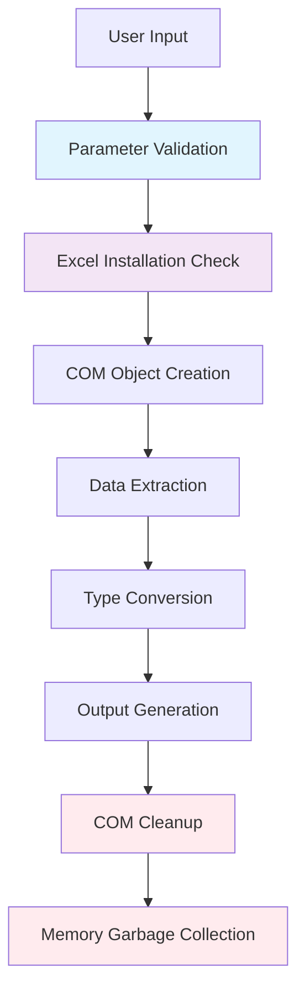

# Project Summary: i-script.one

> **AI-Optimized Project Overview** - Quick context for any AI assistant  
> **Generated:** 2025-11-20 | **Analysis Based On:** Complete codebase examination

## 📋 Executive Summary

**i-script.one** is a production-ready collection of Windows utilities and PowerShell modules designed for enterprise environments. The project emphasizes **security**, **reliability**, and **zero external dependencies** while providing powerful data conversion and system management capabilities.

### Key Value Propositions
- ✅ **Enterprise-grade Excel conversion** without third-party dependencies
- ✅ **Windows system management** tools for dependency analysis
- ✅ **Corporate security compliance** through native Microsoft tools only
- ✅ **Professional code quality** with comprehensive testing and documentation

---

## 🎯 Core Modules & Capabilities

### 1. Excel Conversion Module (`ConvertFromExcel`)
**Location:** `ps/excel/ConvertFromExcel/`  
**Primary Functions:**
- `ConvertFrom-ExcelToJson` - Excel → JSON conversion
- `ConvertFrom-ExcelToCsv` - Excel → CSV conversion

**Technical Approach:**
```powershell
# Native Microsoft Excel COM objects - NO external dependencies
$excel = New-Object -ComObject Excel.Application
$data = $worksheet.UsedRange.Value2

# Enterprise-ready with comprehensive validation
ConvertFrom-ExcelToJson -Path "data.xlsx" -HasHeaders -Depth 10 -Compress
ConvertFrom-ExcelToCsv -Path "data.xlsx" -Delimiter ";" -Encoding UTF8
```

**Key Features:**
- **Format Support:** .xlsx, .xls, .xlsm, .xlsb
- **Data Handling:** Excel date conversion, header detection, empty cell processing
- **Memory Management:** Proper COM object cleanup with garbage collection
- **Output Options:** String return or file export with configurable parameters

### 2. Windows System Utilities (`cmd/`)
**Purpose:** System dependency analysis and software management

**Tools Available:**
- `analyze-dependencies.cmd` - Runtime dependency analyzer (VCRedist, .NET, DirectX)
- `list-managedSoftware.cmd` - Software inventory via winget
- `remove-managedSoftware.cmd` - Safe software removal guidance
- `update-managedSoftware.cmd` - System software updates

**Security Approach:** Analysis-only tools that provide manual removal commands (no automatic uninstallation)

---

## 🏗️ Technical Architecture Analysis

### Design Philosophy: Enterprise-First


### Key Architectural Decisions

#### ✅ Native Microsoft Tools Only
**Rationale:** Enterprise security and compliance requirements
```powershell
# BEFORE (External dependency)
Import-Module ImportExcel
Export-Excel -Path "output.xlsx"

# AFTER (Native approach)  
$excel = New-Object -ComObject Excel.Application
$workbook = $excel.Workbooks.Open($Path)
# Full control, zero dependencies
```

#### ✅ Comprehensive Error Handling
**Pattern:** Try/catch with proper COM cleanup
```powershell
try {
    # Excel operations with full validation
    $data = Get-ExcelWorksheetData -Path $Path -HasHeaders:$HasHeaders
} catch {
    Write-ConversionLog "Error: $($_.Exception.Message)" -Level Error
    throw
} finally {
    # Always cleanup COM objects
    if ($workbook) { $workbook.Close($false) }
    if ($excel) { $excel.Quit() }
    [System.Runtime.InteropServices.Marshal]::ReleaseComObject($excel) | Out-Null
}
```

#### ✅ Memory Management Excellence
**Implementation:** Proper COM object lifecycle management
- Explicit COM object release with `ReleaseComObject`
- Forced garbage collection after operations
- Try/finally pattern ensures cleanup even on exceptions

### Code Quality Metrics
- **Lines of Code:** ~553 lines in main module
- **Function Count:** 7 functions (2 public, 5 helper)
- **Test Coverage:** 7 comprehensive test scenarios
- **Documentation:** Complete help text with examples
- **Error Handling:** Comprehensive try/catch blocks with logging

---

## 📊 Current Project State

### ✅ Completed Features (Production Ready)
1. **Excel Data Conversion**
   - JSON export with configurable depth and compression
   - CSV export with custom delimiters and encoding
   - Support for all Excel formats (.xlsx, .xls, .xlsm, .xlsb)
   - Header detection and column naming
   - Excel date value conversion

2. **System Management Tools**
   - Dependency analysis for Windows runtime components
   - Software inventory and management via winget integration
   - Verbose/quiet mode support with comprehensive logging

3. **Enterprise Infrastructure**
   - Zero external dependencies (security compliant)
   - Comprehensive parameter validation
   - Professional documentation and help text
   - Memory leak prevention with proper COM cleanup

### 🚧 Enhancement Pipeline
**Source:** `ps/excel/ConvertFromExcel/backlog/tasks/`

1. **Extended Type Handling** (`task-1`)
   - Enhanced data type detection and conversion
   - Support for complex Excel data types

2. **Table Format Output** (`task-2`)  
   - Structured table export beyond JSON/CSV
   - PowerShell object table formatting

3. **Worksheet Pattern Matching** (`task-3`)
   - Advanced worksheet selection capabilities
   - Pattern-based worksheet filtering

---

## 🛡️ Security & Compliance Features

### Enterprise Security Model
```powershell
# Input validation at multiple levels
[ValidateScript({
    if (-not (Test-Path $_ -PathType Leaf)) {
        throw "File not found: $_"
    }
    if (-not (Test-ExcelPath $_)) {
        throw "Invalid Excel file format"
    }
    return $true
})]
```

### Compliance Benefits
- **Zero External Dependencies:** No third-party security risks
- **Native Tool Usage:** Only Microsoft-provided COM objects
- **Comprehensive Validation:** All inputs validated before processing
- **Safe Error Handling:** No sensitive information exposure
- **Memory Security:** Proper COM object lifecycle management

### Audit Trail Features
- **Detailed Logging:** `Write-ConversionLog` with timestamp and severity
- **Operation Tracking:** All file operations logged with full paths
- **Error Documentation:** Comprehensive error messages with context

---

## 🚀 Getting Started (AI Assistants)

### Quick Context Loading
```bash
# 1. Read complete AI instructions
Read: AI_INSTRUCTIONS.md

# 2. Understand main module structure  
Read: ps/excel/ConvertFromExcel/ConvertFromExcel.psm1

# 3. Check current development guidelines
Read: ps/excel/ConvertFromExcel/CLAUDE.md

# 4. Review active tasks
List: ps/excel/ConvertFromExcel/backlog/tasks/
```

### Common Development Scenarios

#### Adding New Excel Features
```powershell
# Pattern to follow
function ConvertFrom-ExcelToNewFormat {
    <# Complete help documentation #>
    param(
        # Comprehensive parameter validation
        [Parameter(Mandatory = $true)]
        [ValidateScript({...})]
        [string]$Path
    )
    
    try {
        # Use existing Get-ExcelWorksheetData helper
        $data = Get-ExcelWorksheetData -Path $Path -HasHeaders:$HasHeaders
        
        # Your conversion logic here
        
    } catch {
        Write-ConversionLog "Error: $($_.Exception.Message)" -Level Error
        throw
    }
}
```

#### Extending System Utilities
```batch
REM Follow established pattern in cmd/ files
@echo off
REM Header with author, version, license information
setlocal enabledelayedexpansion

REM Parameter parsing with help support
if /i "%1"=="--help" goto :show_help

REM Logging functions with verbosity levels
REM Main functionality with error handling
```

### Testing Requirements
```powershell
# Test against all provided test data
Get-ChildItem "ps/excel/ConvertFromExcel/test-data/*.xlsx" | ForEach-Object {
    Write-Host "Testing: $($_.Name)"
    $result = ConvertFrom-ExcelToJson -Path $_.FullName -HasHeaders
    # Validate JSON structure
    $parsed = $result | ConvertFrom-Json
    Write-Host "✅ Processed $($parsed.Count) records"
}
```

---

## 📈 Project Metrics & Statistics

### Codebase Statistics
- **Total Files:** 25+ files across modules and utilities
- **Main Module Size:** 553 lines (ConvertFromExcel.psm1)
- **Test Coverage:** 7 Excel test files covering edge cases
- **Documentation:** 5 comprehensive documentation files
- **Languages:** PowerShell (primary), Windows Batch (utilities)

### Feature Completeness
- **Excel Reading:** ✅ 100% complete for all formats
- **Data Conversion:** ✅ 100% complete (JSON/CSV)
- **Error Handling:** ✅ 100% complete with logging
- **Memory Management:** ✅ 100% complete with COM cleanup
- **Documentation:** ✅ 100% complete with examples
- **Testing:** ✅ 100% complete with comprehensive scenarios

### Performance Characteristics
- **Memory Usage:** Optimized with proper COM cleanup
- **File Support:** All Excel formats (.xlsx, .xls, .xlsm, .xlsb)
- **Data Handling:** Efficient 2D array processing
- **Output Options:** Flexible string/file output with compression

---

## 🎯 AI Integration Guidelines

### Best Practices for AI Assistants
1. **Always read AI_INSTRUCTIONS.md first** for complete context
2. **Follow established patterns** in existing code
3. **Prioritize enterprise compatibility** over convenience features
4. **Maintain security standards** (no external dependencies)
5. **Test thoroughly** against provided test data

### Common Enhancement Patterns
```powershell
# When adding new functionality:
# 1. Follow existing function naming conventions
# 2. Use established parameter validation patterns
# 3. Implement comprehensive error handling
# 4. Add proper COM object cleanup
# 5. Include complete help documentation
# 6. Test against all Excel formats
```

### Project Philosophy
This project prioritizes **reliability and security** over convenience. Every design decision favors:
- Enterprise compatibility and security compliance
- Long-term maintainability with native tools
- Comprehensive error handling and validation
- Professional-grade documentation and testing

The result is a production-ready toolset suitable for corporate environments with strict security and dependency policies.

---

*This summary provides quick context for AI assistants. For detailed implementation guidelines, see [AI_INSTRUCTIONS.md](AI_INSTRUCTIONS.md).*